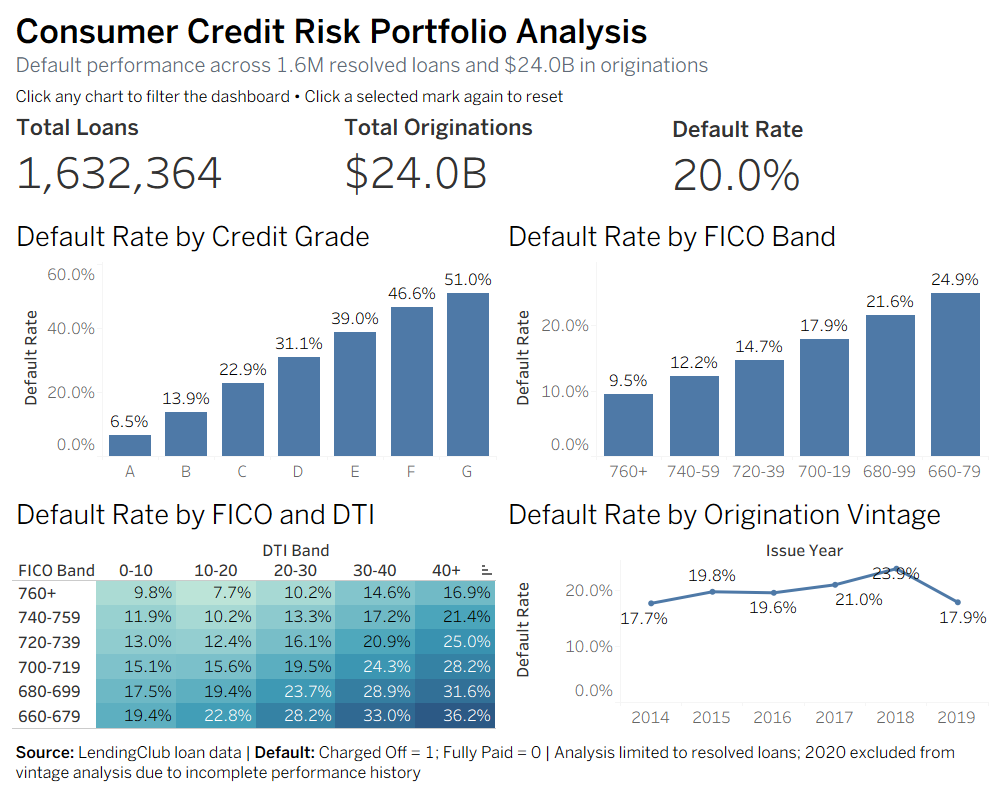

# Consumer Credit Risk Portfolio Analysis

**Python | SQL | Logistic Regression | Tableau | Credit Risk Strategy**

An end-to-end consumer credit risk analytics project examining **1.63 million resolved LendingClub loans** and approximately **$24 billion in historical originations**.

The project combines data cleaning, exploratory analysis, SQL, probability-of-default modeling, and interactive visualization to evaluate borrower risk and inform credit underwriting decisions.

## Executive Summary

Consumer lenders must balance loan growth, credit quality, and profitability. This project investigates how borrower characteristics influence historical loan defaults and evaluates potential underwriting strategies.

**Key results:**

- Analyzed **1,632,364 resolved loans** with an observed default rate of **20.04%**.
- Developed two logistic regression models, improving ROC-AUC from **0.6321 to 0.6914**.
- Identified significant default-rate differences across credit grades, FICO bands, and debt-to-income ratios.
- Simulated FICO underwriting thresholds to quantify the historical trade-off between loan retention and credit quality.
- Developed a Tableau dashboard for interactive portfolio monitoring.

## 1. Business Problem

Consumer lenders must manage credit losses without unnecessarily restricting loan growth.

This project addresses five questions:

1. Which borrower characteristics are most associated with default risk?
2. How effectively do credit grade, FICO, and DTI differentiate risk?
3. Can borrower characteristics predict probability of default?
4. How do stricter underwriting requirements affect historical portfolio performance?
5. How can analytical findings support credit policy and portfolio monitoring?

## 2. Dataset and Methodology

**Source:** LendingClub historical consumer loan data, 2014–2020.

The original dataset contained approximately 2.9 million loan records and 142 variables.

For predictive modeling, the analysis retained loans with resolved outcomes:

- **Fully Paid:** `default_flag = 0`
- **Charged Off:** `default_flag = 1`

The final analytical portfolio contains **1,632,364 resolved loans**.

The modeling process included data cleaning, feature engineering, exploratory analysis, an 80/20 train-test split, logistic regression, and model evaluation.

The raw dataset and large processed files are excluded from GitHub because of their size.

## 3. Portfolio Overview

| Metric | Result |
|---|---:|
| Resolved loans | 1,632,364 |
| Total originations | ~$24.0 billion |
| Observed default rate | 20.04% |
| Average FICO score | ~699 |
| Average interest rate | ~13.1% |

## 4. Exploratory Credit Risk Analysis

### Credit Grade Segmentation

Credit grade demonstrated substantial differentiation in historical default risk.

| Grade | Loans | Default Rate |
|---|---:|---:|
| A | 307,652 | 6.54% |
| B | 471,945 | 13.89% |
| C | 469,987 | 22.95% |
| D | 241,784 | 31.14% |
| E | 101,398 | 38.96% |
| F | 30,346 | 46.63% |
| G | 9,252 | 51.01% |

Grade G loans experienced approximately **7.8 times the default rate** of Grade A loans.

### FICO and Debt-to-Income Analysis

Lower FICO scores and higher debt-to-income ratios were associated with elevated historical default rates.

Combining FICO and DTI segmentation revealed that borrowers with similar credit scores could have meaningfully different risk profiles depending on their debt burden.

**Business implication:** Credit policy should incorporate multiple borrower characteristics rather than relying on a single credit score threshold.

### Origination Vintage Analysis

Historical default rates also varied across origination years.

Vintage comparisons can help identify changes in borrower composition, underwriting standards, or macroeconomic conditions.

However, differences in loan seasoning and observation periods limit direct comparisons between vintages.

## 5. Probability of Default Modeling

Two logistic regression models were developed to estimate borrower-level probability of default.

### Model 1: Baseline

Features:

- FICO score
- Debt-to-income ratio
- Annual income
- Loan amount

### Model 2: Expanded

Additional features:

- Interest rate
- Credit grade

### Model Performance

| Metric | Model 1 | Model 2 |
|---|---:|---:|
| ROC-AUC | 0.6321 | 0.6914 |
| Accuracy | ~79.9% | ~79.9% |

The expanded model improved ROC-AUC by **0.0593**, indicating stronger discriminatory power between borrowers who defaulted and those who repaid.

Interest rate and credit grade provided meaningful predictive information, although these variables also reflect LendingClub's existing risk assessment and pricing decisions.

### Risk Decile Analysis

The expanded model was evaluated by ranking borrowers according to predicted default probability.

| Highest-Risk Population | Share of Observed Defaults Captured |
|---|---:|
| Top 10% | 16.98% |
| Top 20% | 31.26% |
| Top 30% | 43.92% |

These results demonstrate the model's ability to concentrate higher-risk borrowers into targeted review segments.

## 6. SQL Portfolio Analysis

SQL was used to reproduce core credit risk analyses and evaluate historical underwriting strategies.

**SQL techniques demonstrated:**

- Portfolio aggregation using `COUNT`, `SUM`, and `AVG`
- Conditional segmentation using `CASE WHEN`
- `GROUP BY`, `ORDER BY`, and filtering
- Common Table Expressions (CTEs)
- Window functions including `RANK() OVER()` and `SUM() OVER()`
- `CROSS JOIN` operations for portfolio benchmark comparisons
- Subqueries and `UNION ALL` for policy simulation

The analysis includes portfolio KPIs, credit grade rankings, FICO and DTI segmentation, and comparisons against portfolio-level default rates.

**SQL source:** [credit_risk_analysis.sql](sql/credit_risk_analysis.sql)

## 7. Credit Policy Simulation

A retrospective underwriting simulation evaluated how alternative minimum FICO requirements would affect historical loan retention and observed default rates.

| Scenario | Loans Retained | Retention Rate | Default Rate |
|---|---:|---:|---:|
| Existing Portfolio | 1,632,364 | 100.00% | 20.04% |
| Minimum FICO 700 | 660,637 | 40.47% | 15.00% |
| Minimum FICO 720 | 361,115 | 22.12% | 12.56% |

### Key Findings

**FICO ≥ 700**

The observed default rate declined by 5.04 percentage points, while approximately 40% of historical funded loans remained eligible.

**FICO ≥ 720**

The observed default rate declined by 7.48 percentage points, but only approximately 22% of historical funded loans remained eligible.

### Business Interpretation

Stricter underwriting requirements can reduce observed default risk while substantially reducing the eligible lending population.

The findings illustrate the importance of balancing credit quality with loan growth.

Neither threshold can be considered optimal without evaluating expected credit losses, pricing, interest income, funding costs, and risk-adjusted profitability.

These simulations are based on historical funded loans and do not estimate future approval rates or causal policy effects.

## 8. Tableau Dashboard



An interactive Tableau dashboard was developed to monitor portfolio performance across borrower risk segments.

The dashboard includes:

- Portfolio loan count and origination volume
- Observed default rate
- Credit grade segmentation
- FICO bands
- Debt-to-income bands
- Interactive risk filters

The dashboard provides a portfolio-monitoring framework for identifying concentrations of elevated credit risk.

## 9. Business Recommendations

### 1. Implement Multi-Factor Underwriting

Use FICO, DTI, income, and other relevant borrower characteristics together to assess creditworthiness.

### 2. Apply Risk-Based Credit Policies

Evaluate differentiated underwriting requirements for higher-risk borrower segments instead of relying exclusively on a universal minimum FICO threshold.

### 3. Incorporate Probability-of-Default Models

Use validated model scores to support risk ranking, application review, and portfolio monitoring.

### 4. Balance Risk Reduction With Loan Growth

Evaluate policy changes using expected losses, approval volume, risk-adjusted profitability, and customer economics rather than default rates alone.

### 5. Monitor Portfolio Performance

Track changes in borrower mix, credit grade distribution, risk segmentation, and vintage performance to identify potential portfolio deterioration.

## 10. Limitations

- Historical LendingClub performance may not reflect current consumer lending conditions.
- The dataset includes funded loans with resolved outcomes and does not represent the complete applicant population.
- Observed relationships are associative rather than causal.
- Differences in vintage seasoning limit direct comparisons across origination years.
- The modeling exercise does not incorporate loss given default, exposure at default, recoveries, or funding costs.
- Interest rate and credit grade incorporate information from the lender's existing underwriting process.
- Model performance does not establish production readiness; further validation, calibration, stability testing, and fairness assessment would be necessary.

## 11. Technology Stack

| Tool | Application |
|---|---|
| Python | Data preparation and modeling |
| pandas / NumPy | Data manipulation |
| scikit-learn | Logistic regression and model evaluation |
| SQLite / SQL | Portfolio analytics and policy simulation |
| Tableau | Interactive credit risk visualization |
| Git / GitHub | Version control and project documentation |

## 12. Repository Structure

```text
consumer-credit-risk-strategy/
├── README.md
├── .gitignore
├── notebooks/
│   ├── 01_data_cleaning.ipynb
│   ├── 02_data_preparation.ipynb
│   ├── 03_exploratory_risk_analysis.ipynb
│   └── 04_probability_of_default_model.ipynb
├── sql/
│   └── credit_risk_analysis.sql
└── dashboard/
    ├── README.md
    └── credit_risk_dashboard.png
```

## 13. Skills Demonstrated

**Credit Risk:** Portfolio monitoring, borrower segmentation, probability of default, underwriting policy analysis, and risk–growth trade-offs.

**Technical:** Python, SQL, CTEs, window functions, logistic regression, model evaluation, Tableau, and Git.

**Business Analytics:** Translating historical credit performance and predictive model outputs into practical underwriting and portfolio management recommendations.
